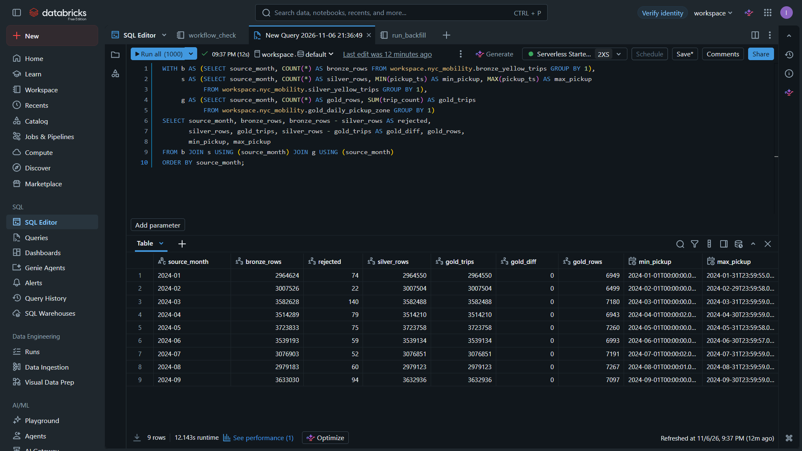
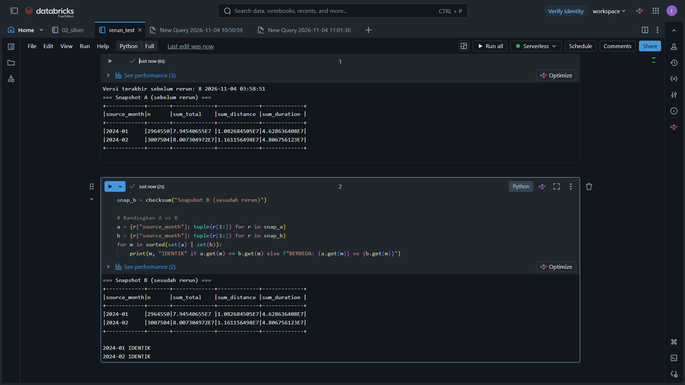
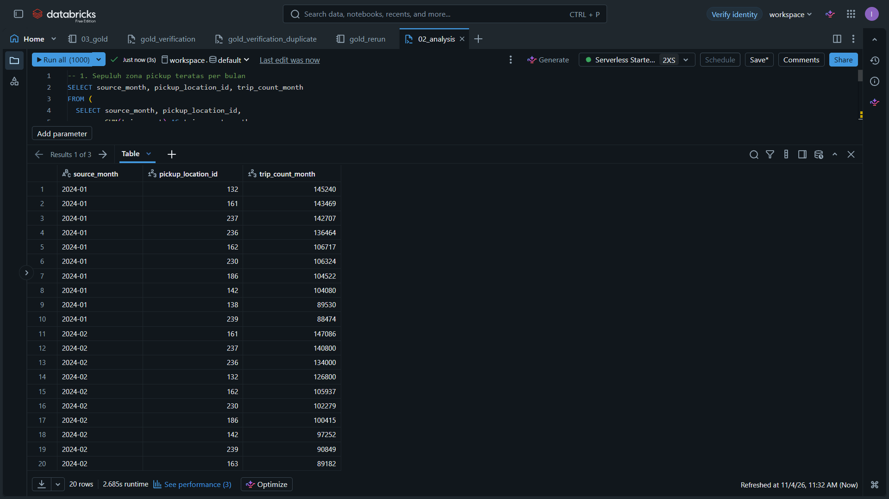

# nyc-mobility-lakehouse

[](https://github.com/ibrahim119920/nyc-mobility-lakehouse/actions/workflows/ci.yml)

A small batch lakehouse for NYC TLC Yellow Taxi data, built with **Databricks, PySpark, SQL, and Delta Lake**.

**Status: run end to end in Databricks.** Nine months of 2024 (January to September) are loaded into Bronze, Silver, and Gold; the month parameter is validated; a February rerun reproduced the same business results without touching January; a failed input wrote nothing; and a Day 7 backfill added March to September through the same job. The claims on this page are backed by the files in [`evidence/`](evidence/README.md).

Scope is deliberately small: one dataset, nine monthly files, four notebooks, three Delta tables, one sequential job. Streaming, dashboards, and deployment automation are not part of it; a small GitHub Actions workflow only runs the automated checks.

## Goals and scope

- Process Yellow Taxi 2024 monthly files, starting with January and February and later backfilling March to September.
- Add a month without removing the previous month.
- Rerun the same month without duplicating results.
- Produce daily trip summaries per pickup zone.
- Keep evidence of data quality, monthly history, and reruns.

## Architecture

```text
NYC TLC: one complete Parquet file per month
                    |
          00_prepare_batch (parameter and input validation)
                    |
          01_bronze (source rows + metadata)
                    |
          02_silver (types, quality rules, derived columns)
                    |
          03_gold (daily aggregation per pickup zone)
                    |
                SQL analysis
```

Input files live in a Unity Catalog Volume (`/Volumes/workspace/nyc_mobility/raw/yellow/`). All three tables are managed in `workspace.nyc_mobility` and partitioned by `source_month` (`YYYY-MM`), taken from the file month rather than from the pickup timestamps.

Writes use `mode("overwrite")` + `replaceWhere "source_month = 'YYYY-MM'"`: only the active month's partition is replaced, and the month is validated before the predicate is built. There is no append and no overwrite without a predicate. See the [batch contract](docs/architecture.md) and the [schema and profiling notes](docs/schema_notes.md).

## Results

Counts after the Day 7 backfill (2026-11-06 21:37 WIB), the same query for all nine months:

| Month | Bronze rows | Silver rows | Rejected | Gold rows | Gold `SUM(trip_count)` |
| --- | --- | --- | --- | --- | --- |
| 2024-01 | 2,964,624 | 2,964,550 | 74 | 6,949 | 2,964,550 |
| 2024-02 | 3,007,526 | 3,007,504 | 22 | 6,499 | 3,007,504 |
| 2024-03 | 3,582,628 | 3,582,488 | 140 | 7,180 | 3,582,488 |
| 2024-04 | 3,514,289 | 3,514,210 | 79 | 6,943 | 3,514,210 |
| 2024-05 | 3,723,833 | 3,723,758 | 75 | 7,260 | 3,723,758 |
| 2024-06 | 3,539,193 | 3,539,134 | 59 | 6,993 | 3,539,134 |
| 2024-07 | 3,076,903 | 3,076,851 | 52 | 7,191 | 3,076,851 |
| 2024-08 | 2,979,183 | 2,979,123 | 60 | 7,267 | 2,979,123 |
| 2024-09 | 3,633,030 | 3,632,936 | 94 | 7,097 | 3,632,936 |

- `SUM(trip_count)` in Gold equals the Silver row count for every month (difference 0). The Gold grain was checked for duplicates for January and February only (`duplicate_grain = 0`).
- Silver rejects 74 / 22 rows in January / February, all from two rules: `dropoff_not_before_pickup` (56 / 7) and `pickup_in_source_month` (18 / 15). The other four rules rejected nothing in these months.
- For March to September the preflight failures add up exactly to the rejected counts (for example 2024-03: 23 outside-month + 117 dropoff-before-pickup = 140 rejected), and the source schema matched Bronze in every month.
- The February rerun left every compared business column identical for both months, moved each table by exactly one Delta version, and changed `last_write` only for February.
- The failed input `2024-03` stopped the job in `prepare` with `FileNotFoundError: Input tidak ditemukan: ...` (input not found); Bronze, Silver, and Gold were not written and their Delta versions stayed at 8 / 12 / 7. The file was uploaded later, and the same month succeeded during the Day 7 backfill.
- January and February were verified unchanged after the backfill: business columns identical, `last_write` unchanged, Delta versions 8 / 12 / 7 -> 15 / 19 / 14 (one version per month per table).

## Analysis

`sql/02_analysis.sql` holds twelve descriptive queries. They were run for all nine months after the backfill; each result is exported as a CSV in [`evidence/day7/07-analysis.md`](evidence/day7/07-analysis.md).

- Trips per day range from 95,631 (January) to 121,098 (September). July is 15.9% below June; September is 26.0% above August.
- The ten busiest pickup zones account for 36.6% to 39.4% of monthly trips; zone IDs 132, 161, and 237 lead most months.
- Credit card is 73.77% of trips with tips equal to 21.94% of fare. Cash tips are not recorded in the source, so the cash figure is not comparable.
- The duration tail is thin but real: the median is 11.6-13.9 minutes, the 99th percentile 60.4-76.8, and the maximum 9,767.5 minutes (April 2024).
- Rejections are 0.00073%-0.00391% of Bronze rows per month, and Gold `SUM(trip_count)` matches Silver in every month.

These are descriptive results, not causal claims. Zones remain numeric IDs.

## Evidence

| Evidence | What it shows |
| --- | --- |
| [`evidence/day2/00-day2-setup.md`](evidence/day2/00-day2-setup.md) | Tables created empty; five `00_prepare_batch` validation cases, three rejected before writing. |
| [`evidence/day3/03-bronze.md`](evidence/day3/03-bronze.md) | Exact source row counts; Delta history v0-v5; per-month overwrite; checksum unchanged after the February rerun. |
| [`evidence/day4/04-silver.md`](evidence/day4/04-silver.md) | Accepted/rejected counts and failures per rule. |
| [`evidence/day5/05-gold.md`](evidence/day5/05-gold.md) | Gold rows, zones, unique grain, reconciliation against Silver. |
| [`evidence/day6/06-rerun-comparison.md`](evidence/day6/06-rerun-comparison.md) | Four job runs, before/after comparison for the rerun, failed-input run, final counts. |
| [`evidence/day7/07-backfill.md`](evidence/day7/07-backfill.md) | Backfill of 2024-03 to 2024-09: preflight per month, seven successful runs, Delta versions, nine-month reconciliation. |
| [`evidence/day7/07-analysis.md`](evidence/day7/07-analysis.md) | Twelve descriptive queries over all nine months: monthly summary, daily/weekday/hourly patterns, zones, payment types, duration tail, reconciliation. Results exported as CSV. |

`evidence/day6/02-monthly-counts.csv` holds the January/February counts in CSV form, and `evidence/README.md` is the index with the full list of honesty notes.

### Selected evidence



*Nine-month reconciliation after the backfill: `SUM(trip_count)` in Gold matches Silver in every month.*



*Silver rerun test: snapshot A and snapshot B are identical for both loaded months.*



*Gold daily aggregation: busiest pickup zones.*

## Folder structure

```text
nyc-mobility-lakehouse/
├── README.md
├── LICENSE
├── .gitignore
├── .gitattributes
├── requirements-dev.txt
├── pyproject.toml
├── .github/
│   └── workflows/
│       └── ci.yml
├── notebooks/
│   ├── 00_prepare_batch.py
│   ├── 01_bronze.py
│   ├── 02_silver.py
│   └── 03_gold.py
├── sql/
│   ├── 00_create_tables.sql
│   ├── 01_quality_checks.sql
│   └── 02_analysis.sql
├── config/
│   ├── README.md
│   ├── batch.example.json
│   └── batch.local.json        (local only, git-ignored)
├── jobs/
│   ├── README.md
│   └── monthly_job.example.json
├── tests/
│   ├── README.md
│   ├── conftest.py
│   ├── test_prepare_batch.py
│   ├── test_repo_contract.py
│   └── fixtures/
│       ├── README.md
│       └── yellow_trips_sample.csv
├── data/
│   └── README.md
├── docs/
│   ├── architecture.md
│   ├── known_gaps.md
│   ├── schema_notes.md
│   └── week_plan.md
└── evidence/
    ├── README.md
    ├── day2/
    ├── day3/
    ├── day4/
    ├── day5/
    ├── day6/
    └── day7/
```

The `.py` files use the Databricks source format so they read like normal Python in Git and can still be imported as notebooks. `sql/` holds the DDL, the quality-check queries (written down, not automated), and the analysis queries. `config/` holds a credential-free configuration sample. `jobs/` holds a tidied summary of the job settings. `tests/` holds the automated checks: the prepare/validation notebook is executed with stub platform objects, and the repository contract is asserted. `docs/` holds the contract, the profiling notes, and the work plan. `evidence/` holds the reviewed run evidence.

## How to rerun

1. Create a Databricks workspace with a catalog, schema, and Volume that your identity can read and write. This project used `workspace.nyc_mobility`.
2. Download the monthly files you want to process and upload them to the Volume as `raw/yellow/<YYYY-MM>/yellow_tripdata_<YYYY-MM>.parquet`; see [`data/README.md`](data/README.md).
3. Copy `config/batch.example.json` to `config/batch.local.json` and adjust the names. The file is git-ignored.
4. Run `sql/00_create_tables.sql` once. Do not recreate the tables between batches, or the Delta history is lost.
5. Import the four notebooks into the workspace under `nyc-mobility-lakehouse/notebooks/` and either:
   - run the job `nyc_mobility_monthly` (four chained tasks: prepare → bronze → silver → gold) with the parameters `source_month` and `config_path`, or
   - run the notebooks in the same order by hand, filling both widgets.
6. For more than one month, run the job once per month, sequentially. The Day 7 backfill did this with a small loop that starts a run, waits for it to finish, and stops at the first failure; the loop itself is not in this repository.
7. To check idempotency, rerun one month and compare the business columns before and after; a rerun adds one Delta version per table and must not change the other months.

`jobs/monthly_job.example.json` is a tidied summary of the job settings, not a deployable export; [`jobs/README.md`](jobs/README.md) explains how to recreate the job. `source_month` defaults to an empty string on purpose: a run without parameters fails validation instead of processing a month whose file may not exist.

## Tests

`tests/` runs without Spark or a Databricks workspace:

- [`tests/test_prepare_batch.py`](tests/test_prepare_batch.py) executes the real `notebooks/00_prepare_batch.py` with stub `dbutils` and `spark` objects, and asserts every rejection path: wrong month format, impossible calendar month, missing `config_path`, incomplete config, missing input file, empty file, and a file with no rows.
- [`tests/test_repo_contract.py`](tests/test_repo_contract.py) asserts the repository contract: three partitioned Delta tables, a validated month before every `replaceWhere` write, no append, identical widget names, the sequential job chain, no hardcoded workspace path, and that every relative Markdown link resolves.

Run them locally with:

```powershell
python -m pip install -r requirements-dev.txt
python -m pytest
ruff check .
```

The same two commands run in GitHub Actions ([`.github/workflows/ci.yml`](.github/workflows/ci.yml)) on every push. The Spark transformations and the Databricks integration scenarios are still verified by hand; the scenario list stays in [`tests/README.md`](tests/README.md).

## Limitations

- The Day 6 test and the Day 7 backfill ran on tables that already contained data. They show rerun idempotency and selective overwrite, not a first-time load from an empty catalog.
- Bronze, Silver, and Gold were run several times during development; the Silver idempotency proof is Delta version 9.
- The Day 6 January run was not photographed while it ran; its run detail (`run_january_detail.png`) and the runs list were captured later from the Runs tab.
- Zones are numeric IDs only. There is no zone-name lookup, so "top zone" results cannot be named.
- There is no unique trip ID in the source, so no deduplication is done. Identical source rows stay identical rows.
- Delta commits are atomic per table, not across the three tables. A failure between tasks can leave the layers at different versions until the month is rerun.
- Single writer, `max_concurrent_runs = 1`, no schedule. Parallel runs were not tested, and every run so far was started manually.
- Negative money values are kept; refund rules and zone-ID validation do not exist. Trip duration is not capped: across the nine months the maximum is 9,767.5 minutes (April 2024), 12-26 trips per month are longer than 24 hours, and 796-1,132 trips per month have zero duration. The Gold average duration is skewed by that tail.
- For March to September only rows, outside-month pickups, dropoff-before-pickup, and schema equality were checked before loading. Null `PULocationID` and negative distance were not measured for those months.
- The 2024-08 backfill run took 11m 6s versus about 1m for the others; the cause was not investigated.
- The analysis is descriptive and was not packaged as automated tests. The CSV result files contain no run timestamp or query ID. October-December 2024 are not loaded, so no full-year claim is made.
- Rejected rows are counted and dropped, not stored in a rejected-rows table.
- The backfill loop and the preflight/snapshot notebook exist only in the Databricks workspace, not in this repository.
- The automated tests cover the input-validation notebook and the repository contract, not the Spark transformations: the Silver/Gold rules and the integration scenarios are still verified by hand in Databricks.

Each gap above, together with the ones recorded only in the evidence notes, is tracked with its impact and next step in [`docs/known_gaps.md`](docs/known_gaps.md).

## License

MIT. See [`LICENSE`](LICENSE).

## References

- [NYC TLC Trip Record Data](https://www.nyc.gov/site/tlc/about/tlc-trip-record-data.page): source of the monthly files and the data dictionary.
- [Databricks selective overwrite](https://docs.databricks.com/aws/en/delta/selective-overwrite): reference for the per-month `replaceWhere` write.
